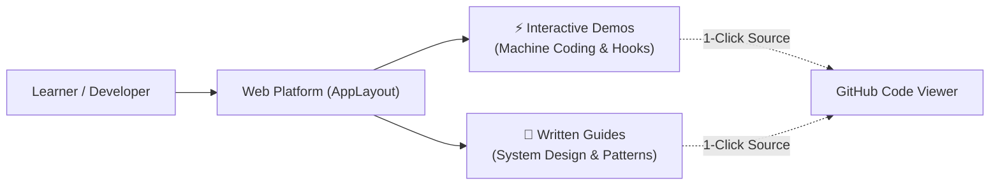

# ⚛️ React Engineering Lab & Architecture Masterclass

> A comprehensive, production-ready educational platform containing interactive **Machine Coding** challenges, real **Company Interview Questions**, in-depth **React Rendering Patterns**, **Frontend System Design**, and **Performance Optimization** guides.

[](https://react.dev)
[](https://www.typescriptlang.org)
[](https://tailwindcss.com)
[](https://parceljs.org)
[](https://opensource.org/licenses/ISC)

---

## 📌 Table of Contents

- [Overview & Architecture](#-overview--architecture)
- [Interactive Machine Coding & LLD](#-interactive-machine-coding--lld)
- [Company Interview Challenges](#-company-interview-challenges)
- [React Hooks & Polyfills](#-react-hooks--polyfills)
- [Rendering Patterns & Architecture](#-rendering-patterns--architecture)
- [Performance & Optimization Techniques](#-performance--optimization-techniques)
- [Frontend System Design](#-frontend-system-design)
- [Web Fundamentals & Networking](#-web-fundamentals--networking)
- [State Management & Engineering Best Practices](#-state-management--engineering-best-practices)
- [Getting Started Locally](#-getting-started-locally)
- [How to Add New Content (Extensibility)](#-how-to-add-new-content-extensibility)

---

## 🚀 Overview & Architecture

This repository is dual-purpose:
1. **Interactive Educational Web Application**: Runs locally or deployed to Vercel/Netlify. Users can browse, search, and live-test machine coding challenges directly in their browser.
2. **Deep-Dive Knowledge Repository**: Contains 30+ peer-reviewed markdown guides covering advanced software design, web standards, and high-scale architecture.



---

## ⚡ Interactive Machine Coding & LLD

Interactive implementations designed to prepare you for frontend machine coding rounds:

| Challenge | Topic / Concept | Source Path |
| :--- | :--- | :--- |
| **Multi-Stepper Wizard** | Multi-stage form flow with progress indicators | [`src/LowLevelDesignAndMachineCoding/MultiStepperComponent`](./src/LowLevelDesignAndMachineCoding/MultiStepperComponent) |
| **Switch-Case Component** | Declarative conditional rendering pattern | [`src/LowLevelDesignAndMachineCoding/SwitchCaseComponent`](./src/LowLevelDesignAndMachineCoding/SwitchCaseComponent) |
| **Two-Step Login Form** | Multi-step authentication flow with validation | [`src/LowLevelDesignAndMachineCoding/TwoStepLoginForm`](./src/LowLevelDesignAndMachineCoding/TwoStepLoginForm) |
| **Infinite Scroll Feed** | High-performance dynamic loading with IntersectionObserver | [`src/LowLevelDesignAndMachineCoding/InfiniteScrollInReact`](./src/LowLevelDesignAndMachineCoding/InfiniteScrollInReact) |
| **Search With Pagination** | Query filtering and pagination controls | [`src/LowLevelDesignAndMachineCoding/SearchWithPagination`](./src/LowLevelDesignAndMachineCoding/SearchWithPagination) |
| **Responsive Slideshow** | Touch & responsive carousel with auto-play | [`src/LowLevelDesignAndMachineCoding/ResponsiveSlideshow`](./src/LowLevelDesignAndMachineCoding/ResponsiveSlideshow) |
| **Functional Modal** | Accessible modal dialog with backdrop dismissal | [`src/LowLevelDesignAndMachineCoding/FunctionalModalComponent`](./src/LowLevelDesignAndMachineCoding/FunctionalModalComponent) |
| **Nested Checkbox Tree** | Recursive hierarchical tree with indeterminate states | [`src/LowLevelDesignAndMachineCoding/CreateANestedCheckboxTreeComponent`](./src/LowLevelDesignAndMachineCoding/CreateANestedCheckboxTreeComponent) |
| **Feature Flag System** | Context API powered dynamic feature toggles | [`src/LowLevelDesignAndMachineCoding/ImplementFeatureFlagComponentInReact`](./src/LowLevelDesignAndMachineCoding/ImplementFeatureFlagComponentInReact) |
| **Search Auto-Complete** | Debounced suggestions with network query integration | [`src/screens/SearchWithAutoComplete.tsx`](./src/screens/SearchWithAutoComplete.tsx) |
| **Overlapping Circles** | Coordinate math & canvas collision detection | [`src/LowLevelDesignAndMachineCoding/DetectOverLappingCircle`](./src/LowLevelDesignAndMachineCoding/DetectOverLappingCircle) |
| **ToDo List Application** | Classic CRUD state management | [`src/LowLevelDesignAndMachineCoding/ToDoList`](./src/LowLevelDesignAndMachineCoding/ToDoList) |

---

## 💼 Company Interview Challenges

Real frontend questions asked during engineering interviews at top companies:

| Company | Level / Role | Problem | Solution |
| :--- | :--- | :--- | :--- |
| **Abhibus** | SDE-2 | **Editable ToDo List**: In-place inline edit, cancel, and persistence | [`EditableToDoList`](./src/LowLevelDesignAndMachineCoding/EditableToDoList) |
| **Zamp.ai** | Frontend | **Recursive Nested Comments**: Infinite depth threaded discussion tree | [`CreateNestedCommentsInReact`](./src/LowLevelDesignAndMachineCoding/CreateNestedCommentsInReact) |
| **ThoughtSpot** | SDE-2 | **useMemo() Polyfill**: Custom implementation of React's dependency cache | [`UseMemoHookPolyfill`](./src/screens/UseMemoHookPolyfill) |

---

## 🪝 React Hooks & Polyfills

Deep-dive demos into React's reactive primitives and custom hook design:

- **Custom Hooks**:
  - `useDebounce`: Rate-limiting rapid inputs for network optimization.
  - `usePrevious`: Capturing prior render state with refs.
  - `useAsync`: Wrapping promises with loading, resolved, and error state.
  - `useIdle`: Detecting user inactivity across mouse and keyboard events.
  - `useReducer`: Managing complex multi-branch state transitions.
- **React APIs & Core Lifecycle**:
  - `useState`, `useEffect`, `useMemo`, `useRef`, `useContext`
  - `React.memo` & component re-render skipping
  - `React.lazy` & `<Suspense>` route-level chunking
  - DOM Event Propagation: Bubbling vs Capturing (Trickling)
  - Dedicated Web Worker computational offloading

---

## 🎨 Rendering Patterns & Architecture

In-depth technical guides exploring component composability and architectural paradigms:

- [**Compound Component Pattern**](./RenderingPatterns/Compund%20Pattern%20in%20React.md): Designing declarative APIs with shared implicit state.
- [**Container & Presentational Pattern**](./RenderingPatterns/Container%20Presentational%20Pattern%20in%20React.md): Separating data fetching from pure UI rendering.
- [**Higher-Order Components (HOC)**](./RenderingPatterns/Higher-Order%20Component%20Pattern%20in%20React.md): Logic reuse through function composition.
- [**Advanced Component Patterns**](./RenderingPatterns/Advance%20React%20Component%20Patterns.md): Render props, state reducer, and control inversion.
- [**Provider Data Passing**](./RenderingPatterns/Provider%20Data%20Passing%20in%20React.md): Eliminating prop drilling with scoped contexts.
- [**CSR vs SSR Comparison**](./RenderingPatterns/Client-side%20rendering%20vs%20Server-side%20rendering.md): Tradeoffs in TTFB, FCP, LCP, and SEO.
- [**Selective vs Progressive Hydration**](./RenderingPatterns/Selective%20vs%20Progressive%20Hydration.md): React 18 streaming architecture.
- [**ISR vs SSG**](./RenderingPatterns/Incremental%20Static%20Re-Rendering%20vs%20Server-Side%20Generated.md): Static caching models and on-demand background regeneration.

---

## 🚀 Performance & Optimization Techniques

High-impact strategies for blazing-fast web performance and Core Web Vitals optimization:

- [**Code Splitting**](./Optimization%20Techniques/Code%20Splitting.md): Dynamic imports and route-based bundle reduction.
- [**Tree Shaking**](./Optimization%20Techniques/Tree%20Shaking.md): Static ES module analysis and dead code elimination.
- [**List Virtualization & Windowing**](./Optimization%20Techniques/List%20Virtualization.md): Rendering 100,000+ items at 60fps.
- [**Adaptive Loading**](./Optimization%20Techniques/Adaptive%20Loading.md): Tuning features based on device memory and network bandwidth.
- [**Efficient Media Loading**](./Optimization%20Techniques/Efficient%20Loading%20of%20Media.md): AVIF/WebP, responsive `srcset`, and blur placeholders.
- [**Async & Defer Scripts**](./Optimization%20Techniques/Load%20script%20efficiently%20with%20async%20and%20defer.md): Eliminating parser-blocking script tags.
- [**Pagination: Offset vs Cursor**](./Optimization%20Techniques/Pagination%20-%20Offset%20vs%20Cursor-Based.md): Database performance and infinite scroll deduplication.
- [**Background Data Sync**](./Optimization%20Techniques/Periodically%20synchronize%20data%20in%20the%20background.md): Background Sync API and service worker synchronization.
- [**Reactivity in JS Frameworks**](./Optimization%20Techniques/Reactivity%20in%20JavaScript%20frameworks.md): Comparing Virtual DOM, Proxies, and Signals.

---

## 🏗️ Frontend System Design

Architecture blueprints for large-scale production applications:

- [**55 Frontend System Design Core Concepts**](./Frontend%20System%20Design%20Questions/55%20Frontend%20System%20Design%20Concepts%20(React%20Focused).md): The master cheatsheet covering state, network, caching, rendering, security, and scaling.
- [**Design a Video Streaming Platform (YouTube)**](./Frontend%20System%20Design%20Questions/Sample-%20Design%20a%20video%20streaming%20app%20like%20youtube.md): Video buffering, recommendation feeds, comments tree, and offline resilience.

---

## 🌐 Web Fundamentals & Networking

Core browser principles every senior engineer must master:

- [**How a Web Page is Rendered in the Browser**](./Web%20Fundamentals/How%20a%20web%20page%20is%20rendered%20in%20the%20browser.md): DOM, CSSOM, Render Tree, Layout, Paint, and Compositing.
- [**Content Delivery Networks (CDN)**](./Web%20Fundamentals/CDN.md): Edge caching, Anycast routing, and invalidation rules.
- [**Hosting Frontend Applications**](./Web%20Fundamentals/Different%20ways%20to%20host%20a%20frontend%20application.md): S3 + CloudFront, Vercel, Docker containers, and VPS setup.
- [**Frontend Testing Strategies**](./Web%20Fundamentals/Testing%20Startergies.md): Unit, integration, and E2E testing with the Test Pyramid.
- [**REST vs SOAP APIs**](./Web%20Fundamentals/Rest%20Api%20vs%20SOAP%20Api.md): Protocol comparison, security, and message formats.
- [**Types of Web APIs**](./Web%20Fundamentals/Type%20of%20Api's.md): REST, GraphQL, gRPC, and WebSockets.

---

## 💾 State Management & Engineering Best Practices

- [**Client Storage Comparison**](./State%20Management/Cookies,%20Session,%20Local%20storage,%20Indexdb.md): Cookies, LocalStorage, SessionStorage, and IndexedDB.
- [**Frontend Data Normalization**](./State%20Management/Data%20Normalization.md): Normalizing complex nested server payloads into indexed tables.
- [**Singleton Design Pattern**](./Design%20Pattern/Singleton.md): Ensuring single instance lifecycle in JavaScript.
- [**Frontend Style Guide**](./Styling/Style%20Guide.md): Architecture conventions, folder structure, and linting standards.
- [**Production PR Template**](./Code%20Management/Pr%20Template.md): Comprehensive checklist for code reviews and QA.

---

## 💻 Getting Started Locally

### Prerequisites
- Node.js (v18 or higher recommended)
- npm or yarn

### Installation & Run

1. Clone the repository:
   ```bash
   git clone https://github.com/Asharalikhan4/React.git
   cd React
   ```

2. Install dependencies:
   ```bash
   npm install
   ```

3. Start development server:
   ```bash
   npm run start
   ```
   Open [http://localhost:1234](http://localhost:1234) in your browser.

4. Build for production:
   ```bash
   npm run build
   ```

---

## ➕ How to Add New Content (Extensibility)

The platform utilizes a **single source of truth** registry (`src/data/topics.tsx`). Adding new content requires zero manual router or navigation wiring.

### Adding an Interactive Machine Coding Component:
1. Create your component in `src/LowLevelDesignAndMachineCoding/MyNewComponent/MyNewComponent.tsx`.
2. Add an entry to `src/data/topics.tsx`:
   ```tsx
   {
     id: 'my-new-component',
     slug: 'my-new-component',
     title: 'My New Component',
     description: 'Brief description of what this does.',
     category: 'Machine Coding',
     type: 'interactive',
     githubPath: 'src/LowLevelDesignAndMachineCoding/MyNewComponent/MyNewComponent.tsx',
     component: MyNewComponent,
     tags: ['UI', 'Hooks'],
   }
   ```

### Adding a Written Article:
1. Place your markdown document in the appropriate folder (e.g. `RenderingPatterns/MyArticle.md`).
2. Add the `bundle-text:` import in `src/data/articles.ts`.
3. Add the topic entry to `src/data/topics.tsx` with `type: 'article'`.
4. It will immediately show up on the dashboard, in search, in category filters, and render with rich typography and an auto-generated Table of Contents!

---

## 📄 License

This repository is distributed under the ISC License. Free to use for personal learning and interview preparation.
